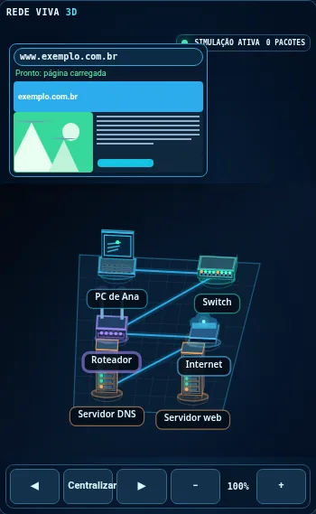
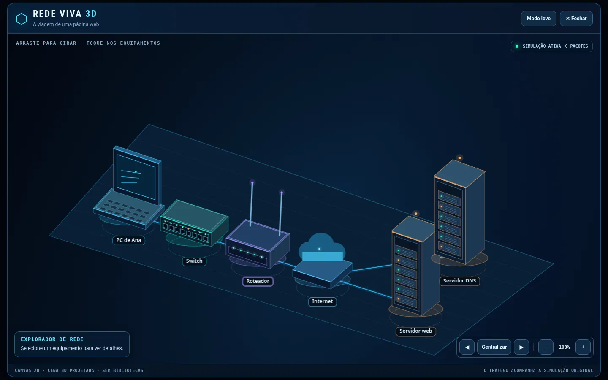
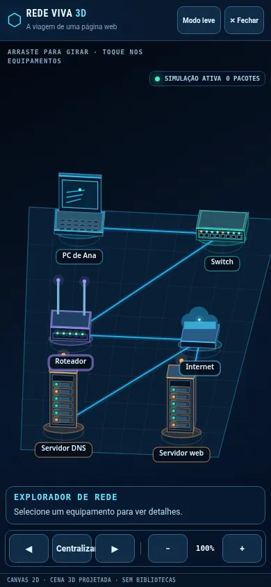

<div align="center">

# 🌐 REDES VIVAS

### O universo vivo das redes de computadores

**12 módulos preservados • 3D direto nos laboratórios • Simulações interativas • Compatível com celular**

🎮 **[Abrir a demonstração ao vivo](https://redes-vivas.vercel.app/)** · 💻 [Código-fonte](https://github.com/jmrzd/Redes-Vivas)

   

</div>

## Prévia


**Versão para celular:**



**Explorador opcional em tela cheia — renderização em Canvas 2D:**





## Sobre

**Redes Vivas** é um simulador educacional de **Introdução à Rede de Computadores**, criado para facilitar a compreensão de protocolos, equipamentos, tráfego, segurança e desempenho. O usuário pode acompanhar pacotes passando pela rede, alterar parâmetros, avançar os eventos passo a passo e resolver desafios.

A experiência visual inclui uma **cena 3D estilizada animada em Canvas 2D**, com equipamentos construídos em faces geométricas, luzes de status, portas de rede, antenas, telas, câmera em movimento e pacotes percorrendo os cabos. **Todos os laboratórios agora usam modelos com volume específicos para equipamentos de rede**, mantendo todos os módulos e suas regras de simulação. Não utiliza WebGL ou bibliotecas pesadas.

> **Importante:** as redes, endereços e comandos do projeto são **simulados** para fins didáticos. A aplicação não envia pacotes reais, não consulta servidores DNS reais e não executa varreduras externas.

## Os 12 módulos

| Nº | Módulo | Você aprende |
|:--:|---|---|
| 01 | Início | Objetivos, navegação, missões e progresso. |
| 02 | Camadas OSI e TCP/IP | Encapsulamento e passagem entre camadas. |
| 03 | TCP × UDP | Confirmações, retransmissão e entrega. |
| 04 | Página web | DNS, conexão TCP e solicitação HTTP. |
| 05 | Comutação | Switch, tabela MAC e roteamento. |
| 06 | Topologias | Estrela, barramento, anel, malha e falhas. |
| 07 | Meios | Cobre, fibra e Wi-Fi; distância e interferência. |
| 08 | Diagnóstico | `ping`, `tracert`, `ipconfig` e `nslookup` simulados. |
| 09 | Segurança | Regras de firewall, HTTP/HTTPS e DDoS didático. |
| 10 | Desempenho | Latência, largura de banda, perda e gargalos. |
| 11 | Tendências | Computação em nuvem, IoT e SDN. |
| 12 | Glossário e quiz | Conceitos, siglas e questões de revisão. |

## Visual 3D leve

A abertura agora utiliza uma **placa de circuitos em perspectiva**, com:

- **Modelos com volume:** notebook com tela e teclado; switch com portas de rede; roteador com antenas; racks de servidores com ventoinhas e LEDs.
- **Animação de rede:** pacotes luminosos percorrem os enlaces; anéis indicam os nós ativos e a câmera se move suavemente.
- **Interação:** arraste para girar a cena, role para aproximar, clique nos equipamentos e use *Explorar o universo* para mudar o ângulo.
- **Interior do laboratório:** dispositivos desenhados com geometria sombreada e modelos distintos, respeitando as posições e áreas clicáveis existentes.
- **Modo leve e acessibilidade:** limita a resolução, reduz efeitos e respeita `prefers-reduced-motion`.

**Como funciona:** o projeto usa **projeção 3D desenhada em Canvas 2D**, sem Three.js, WebGL, downloads de modelos ou texturas externas. Os equipamentos são modelos vetoriais estilizados, não malhas 3D de jogos. Assim, a abertura permanece leve inclusive em celulares.

## Laboratório 3D leve nos 12 tópicos

- Os **10 tópicos com simuladores** exibem equipamentos volumétricos em Canvas 2D; **Início e Glossário/quiz** também mostram uma mini-rede ilustrada e animada que leva à simulação da página web.
- Equipamentos com geometria original: computadores, switches, hubs, roteadores, servidores, firewalls, dispositivos sem fio, sensores, câmeras, nuvem, IoT, controladores e outros elementos das cenas.
- Controles **◀ / ▶** em cada simulação mudam o **ângulo aparente dos equipamentos** e o ponto de fuga do piso. É uma projeção estilizada, **não uma câmera WebGL livre**.
- Controles **− / +** aproximam a câmera de 100% a 225%; após aproximar, arraste o palco com o mouse ou o dedo para explorar a rede. Os cliques nos nós e nos pacotes continuam funcionando por transformação inversa de coordenadas.
- LED e base luminosa reagem à atividade; os pacotes continuam representando a lógica real da **simulação didática**, não tráfego externo.
- Arte de equipamentos pré-renderizada com cache (sem criar gradientes de novo a cada quadro); taxas de quadros reduzidas no celular, DPI limitado e **Modo leve** opcional.
- Layout mobile com 12 abas roláveis horizontalmente, botões maiores, palco alto e painéis empilhados; respeita preferências do sistema para redução de movimento.

## Visualização 3D padrão, sem janela separada

Nos **10 módulos com laboratórios**, a **Cena 3D** é exibida no palco por padrão, com equipamentos e conexões projetados em perspectiva. Os controles originais — iniciar, pausar, próximo passo, reiniciar, Experimente, Inspetor e registro — continuam ao lado da cena e usam a mesma lógica.

- **◈ Cena 3D:** perspectiva isométrica, dispositivos com volume, câmera orbital por arrasto, zoom, pacotes e estados reais da simulação.
- **▤ Diagrama:** restaura a representação educativa clássica, com recursos específicos e áreas clicáveis de cada tópico. Os modos compartilham o estado do experimento.
- **Camadas OSI/TCP-IP:** o diagrama obrigatório de encapsulamento foi preservado e convertido em blocos 3D extrudados e selecionáveis, tanto para OSI quanto para TCP/IP.
- **◈ Explorar cena 3D:** permanece disponível como opção de tela cheia, mas não é necessário para visualizar o laboratório 3D.
- **Interação na cena:** clique ou toque para inspecionar equipamentos; cabos podem ser desligados e religados na visão 3D quando o cenário permitir.
- **Mobile:** dispositivos distribuídos em linhas, enquadramento próprio e controles de toque. O detalhe do equipamento aparece somente após a seleção, preservando o espaço.
- **Economia de desempenho:** apenas a cena visível é renderizada, com Canvas 2D, limite de resolução, taxa de quadros menor em celulares e modo leve.

A aparência é **3D projetado em Canvas 2D**, não malhas WebGL. Isso evita dependências externas e preserva a leveza do site.

## Principais recursos

- **Introdução interativa:** rede com projeção 3D, animações de pacotes, movimentação do ângulo e inspeção dos equipamentos.
- **12 módulos originais preservados**, com cenários próprios e explicações guiadas.
- **Laboratório controlável:** iniciar, pausar, reiniciar, próximo passo e alterar velocidade.
- **Interatividade:** controles de cenário, testes, missões, log de eventos e inspeção de componentes.
- **Acessibilidade:** comandos por teclado, tema claro/escuro e respeito à preferência de redução de movimento.
- **Desempenho:** renderização com resolução limitada em telas de alta densidade, modo leve e sem pacotes externos.
- **Responsividade:** layout adaptado a telas menores.

## Rodar no computador

1. Baixe ou clone o repositório.
2. Abra **`index.html`** no Chrome, Edge ou Firefox.
3. Clique em **Abrir laboratório** ou em **Iniciar demonstração**.

Não é necessário instalar Node.js, Python nem baixar bibliotecas. Se preferir trabalhar com o VS Code, use **Live Server**.

```bash
git clone https://github.com/jmrzd/Redes-Vivas.git
cd Redes-Vivas
```

> Você também pode acessar o site diretamente em **https://redes-vivas.vercel.app/**.

## Controles

| Tecla / ação | Função |
|---|---|
| `Esc` | Fecha a abertura. |
| Arrastar na abertura | Muda o ângulo de visão da rede. |
| Clique nos equipamentos da abertura | Mostra a função do dispositivo. |
| Roda do mouse na abertura | Aproxima ou afasta a rede. |
| `Espaço` | Inicia ou pausa a simulação quando o foco permite. |
| `→` | Avança um passo da simulação. |
| `R` | Reinicia o cenário. |
| `PageUp` / `PageDown` | Navega entre módulos. |
| `+` / `-` | Ajusta a velocidade. |
| **Modo leve** | Reduz efeitos para equipamentos de menor desempenho. |
| **◀ / ▶** | Altera o ângulo aparente dos equipamentos em cada laboratório 3D. |
| **◈ Cena 3D / ▤ Diagrama** | Alterna a cena 3D padrão e o diagrama técnico sem reiniciar a simulação. |
| **◈ Explorar cena 3D** | Abre a opção em tela cheia, com os pacotes sincronizados. |
| **Arrastar no explorador** | Orbita a câmera 3D e ajusta sua inclinação. |
| **Esc** no explorador | Fecha o explorador e volta ao laboratório sem reiniciar o cenário. |
| **− / +** | Afasta ou aproxima a rede (até 225%). Quando ampliada, arraste para navegar. |

## Estrutura

```text
Redes-Vivas/
├── index.html           # Entrada e tela de abertura
├── css/
│   ├── styles.css       # Estilos da aplicação original
│   └── netverse.css     # Estilo futurista e responsividade
├── js/
│   ├── config.js        # Dados do projeto e integrantes
│   ├── lab3d.js         # Desenhos dos equipamentos 3D, cache e mini-rede
│   ├── studio3d.js      # Explorador 3D com câmera, pacotes e modo leve
│   ├── app.js           # Motor original + 12 laboratórios
│   └── intro.js         # Abertura 3D, interações e modo leve
├── assets/
│   ├── favicon.svg      # Identidade visual
│   ├── preview-intro.webp  # Captura da abertura 3D
│   ├── preview-laboratorio.webp # Captura de um cenário
│   ├── preview-mobile.webp      # Laboratório no celular
│   ├── preview-studio-desktop.webp # Explorador 3D no PC
│   └── preview-studio-mobile.webp  # Explorador 3D no celular
└── README.md
```

## Personalização

Edite **`js/config.js`** para preencher instituição, turma, professor e integrantes. O arquivo começa com o objeto `window.REDES_VIVAS`.

## Publicação na Vercel

O repositório está conectado ao projeto **`redes-vivas`** na Vercel. O site usa a raiz do projeto e **não tem etapa de build** (HTML, CSS e JavaScript estáticos).

1. Abra [redes-vivas.vercel.app](https://redes-vivas.vercel.app/).
2. O código-fonte está em [github.com/jmrzd/Redes-Vivas](https://github.com/jmrzd/Redes-Vivas).
3. Alterações na branch `main` acionam o fluxo de implantação conectado na Vercel.

## Testes

As **12 abas** foram testadas com navegador Chromium automatizado em **1440 × 900, 390 × 844 e 320 × 700**. Foram exercitados troca de módulos, abertura/fechamento do explorador, botões 3D, início/reinício de cenários, sintaxe dos scripts e ausência de rolagem horizontal. O explorador também foi verificado com uma simulação em andamento e com modo leve ativado.

No navegador de teste sem aceleração gráfica, o tempo médio de **desenho da cena 3D foi aproximadamente 0,7–0,8 ms por quadro**. FPS medido nesse navegador varia com as limitações de execução automatizada e **não garante 60 FPS em todo PC ou 30 FPS em todo celular**. O desempenho e a temperatura ainda devem ser conferidos em aparelhos reais.

## Créditos

Trabalho acadêmico de **Introdução à Rede de Computadores** — **Afya**. O código original informa ter sido gerado com apoio de **Claude** e revisado pelo grupo. Esta versão foi reorganizada e recebeu uma camada visual e interativa adicional com apoio do **ChatGPT**. Preencha os nomes dos participantes em `js/config.js` antes da entrega.

---

<div align="center"><sub>Projeto educacional • HTML, CSS e JavaScript sem frameworks</sub></div>


