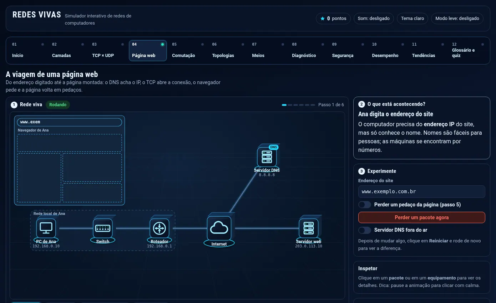

<div align="center">

# 🌐 REDES VIVAS

### O universo vivo das redes de computadores

**Um laboratório interativo com 12 módulos, cenários animados e visualização em perspectiva 3D — direto no navegador.**

   

</div>

[**Acessar repositório**](https://github.com/jmrzd/Redes-Vivas) · [**Abrir simulador (GitHub Pages, após ativação)**](https://jmrzd.github.io/Redes-Vivas/)

## Prévia




## Sobre

**Redes Vivas** é um simulador educacional de **Introdução à Rede de Computadores**, criado para facilitar a compreensão de protocolos, equipamentos, tráfego, segurança e desempenho. O usuário pode acompanhar pacotes passando pela rede, alterar parâmetros, avançar os eventos passo a passo e resolver desafios.

A experiência visual utiliza uma **abertura 3D projetada em Canvas 2D**: equipamentos com faces, perspectiva, movimento de câmera e conexões animadas. O laboratório conserva as simulações originais e apresenta equipamentos com aparência tridimensional estilizada. **Não utiliza WebGL nem modelos 3D pesados**, para funcionar em computadores e celulares mais modestos.

> **Importante:** as redes, endereços e comandos do projeto são **simulados** para fins didáticos. A aplicação não envia pacotes reais, não consulta servidores DNS reais e não executa varreduras externas.

## Os 12 módulos

| Nº | Módulo | Você aprende |
|:--:|---|---|
| 01 | Início | Objetivos, navegação, missões e progresso. |
| 02 | Camadas OSI e TCP/IP | Encapsulamento e passagem entre camadas. |
| 03 | TCP × UDP | Confirmações, retransmissão e entrega. |
| 04 | Página web | DNS, conexão TCP e solicitação HTTP. |
| 05 | Comutação | Switch, tabela MAC e roteamento. |
| 06 | Topologias | Estrela, barramento, anel, malha e falhas. |
| 07 | Meios | Cobre, fibra e Wi-Fi; distância e interferência. |
| 08 | Diagnóstico | `ping`, `tracert`, `ipconfig` e `nslookup` simulados. |
| 09 | Segurança | Regras de firewall, HTTP/HTTPS e DDoS didático. |
| 10 | Desempenho | Latência, largura de banda, perda e gargalos. |
| 11 | Tendências | Computação em nuvem, IoT e SDN. |
| 12 | Glossário e quiz | Conceitos, siglas e questões de revisão. |

## Principais recursos

- **Introdução interativa:** rede com projeção 3D, animações de pacotes, movimentação do ângulo e inspeção dos equipamentos.
- **12 módulos originais preservados**, com cenários próprios e explicações guiadas.
- **Laboratório controlável:** iniciar, pausar, reiniciar, próximo passo e alterar velocidade.
- **Interatividade:** controles de cenário, testes, missões, log de eventos e inspeção de componentes.
- **Acessibilidade:** comandos por teclado, tema claro/escuro e respeito à preferência de redução de movimento.
- **Desempenho:** renderização com resolução limitada em telas de alta densidade, modo leve e sem pacotes externos.
- **Responsividade:** layout adaptado a telas menores.

## Rodar no computador

1. Baixe ou clone o repositório.
2. Abra **`index.html`** no Chrome, Edge ou Firefox.
3. Clique em **Abrir laboratório** ou em **Iniciar demonstração**.

Não é necessário instalar Node.js, Python nem baixar bibliotecas. Se preferir trabalhar com o VS Code, use **Live Server**.

```bash
git clone https://github.com/jmrzd/Redes-Vivas.git
cd Redes-Vivas
```


## Controles

| Tecla / ação | Função |
|---|---|
| `Esc` | Fecha a abertura. |
| Arrastar na abertura | Muda o ângulo de visão da rede. |
| Clique nos equipamentos da abertura | Mostra a função do dispositivo. |
| Roda do mouse na abertura | Aproxima ou afasta a rede. |
| `Espaço` | Inicia ou pausa a simulação quando o foco permite. |
| `→` | Avança um passo da simulação. |
| `R` | Reinicia o cenário. |
| `PageUp` / `PageDown` | Navega entre módulos. |
| `+` / `-` | Ajusta a velocidade. |
| **Modo leve** | Reduz efeitos para equipamentos de menor desempenho. |

## Estrutura

```text
Redes-Vivas/
├── index.html           # Entrada e tela de abertura
├── css/
│   ├── styles.css       # Estilos da aplicação original
│   └── netverse.css     # Estilo futurista e responsividade
├── js/
│   ├── config.js        # Dados do projeto e integrantes
│   ├── app.js           # Motor original + 12 laboratórios
│   └── intro.js         # Abertura 3D, interações e modo leve
├── assets/
│   └── favicon.svg      # Identidade visual
└── README.md
```

## Personalização

Edite **`js/config.js`** para preencher instituição, turma, professor e integrantes. O arquivo começa com o objeto `window.REDES_VIVAS`.

## Publicar gratuitamente com GitHub Pages

1. Envie os **arquivos e pastas extraídos** para a raiz do repositório (não envie apenas o `.zip`).
2. Acesse **Settings → Pages** no repositório.
3. Em *Build and deployment*, selecione **Deploy from a branch**.
4. Selecione `main`, pasta `/ (root)` e clique em **Save**.
5. Após a publicação, o endereço costuma seguir o formato `https://jmrzd.github.io/Redes-Vivas/`.

## Créditos

Trabalho acadêmico de **Introdução à Rede de Computadores** — **Afya**. O código original informa ter sido gerado com apoio de **Claude** e revisado pelo grupo. Esta versão foi reorganizada e recebeu uma camada visual e interativa adicional com apoio do **ChatGPT**. Antes da apresentação, preencha os nomes dos participantes em `js/config.js`.

---

<div align="center"><sub>Projeto educacional • HTML, CSS e JavaScript sem frameworks</sub></div>
